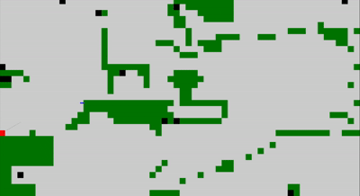
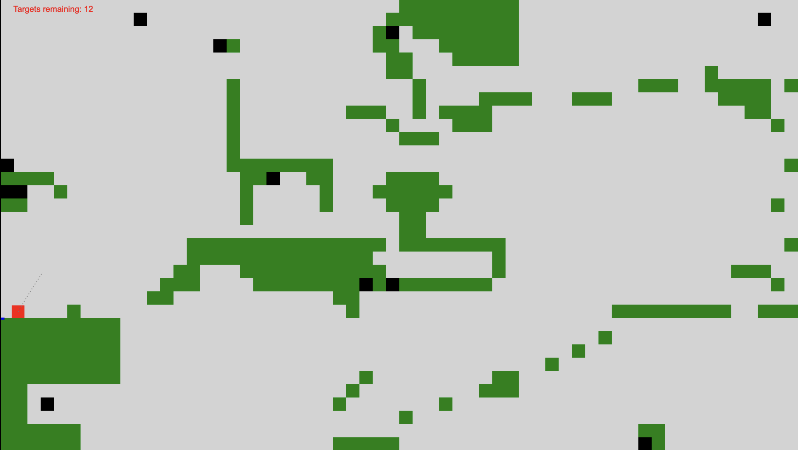
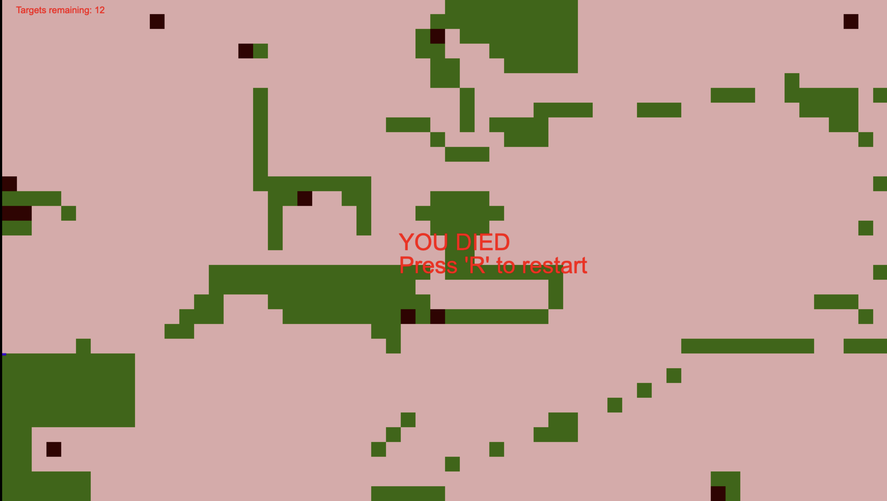
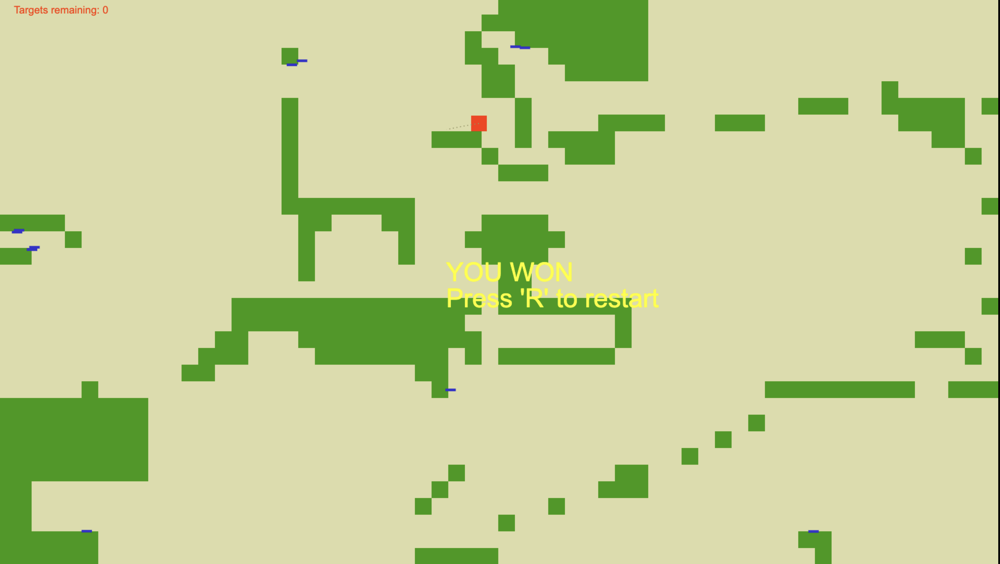

# ARCHER PARKOUR

**A cool browser game where you play an archer and have to pass a level by shooting at every target on the map**

## Screenshots & gameplay

 
 

## Usage

Starting this game is just as easy as opening this link [Archer Parkour](https://belakind.github.io/archer-parkour/) in your browser. Have fun playing!

## Controls

- Use A/D to move left and right (or arrow keys)
- Space to jump
- At start you have to click somewhere in the website once then you can aim by moving up and down with your mouse
- left-click to shoot
- esc to unlock your cursor
- press R to respawn when you died or won

## Built with

This game is completly built with vanilla browser technologies, mostly with javascript. No external frameworks or libraries were used.

- **HTML5** Just for the basic structure (creating a canvas element and loading every needed .js file)
- **CSS3** Used for styling. In this case to give the canvas a size and aspect ratio
- **JavaScript (ES6+)** Powers the complete game (mechanics, rendering, world, logic)

## Coming soon

- textures for the world, player and arrows
- more and better animations for all objects
- enemies
- multiple levels
- pause menu

## Known bugs

- when the player's aim line touches a targets it vanishes just like it was shot

## Side note

I'm building this game for terra by Hack Club. This was my work of the first weeks, updates will come in the next weeks of the terra event.