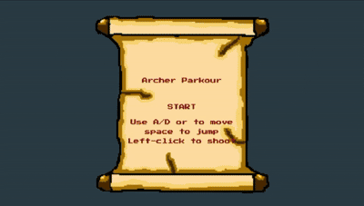
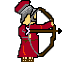
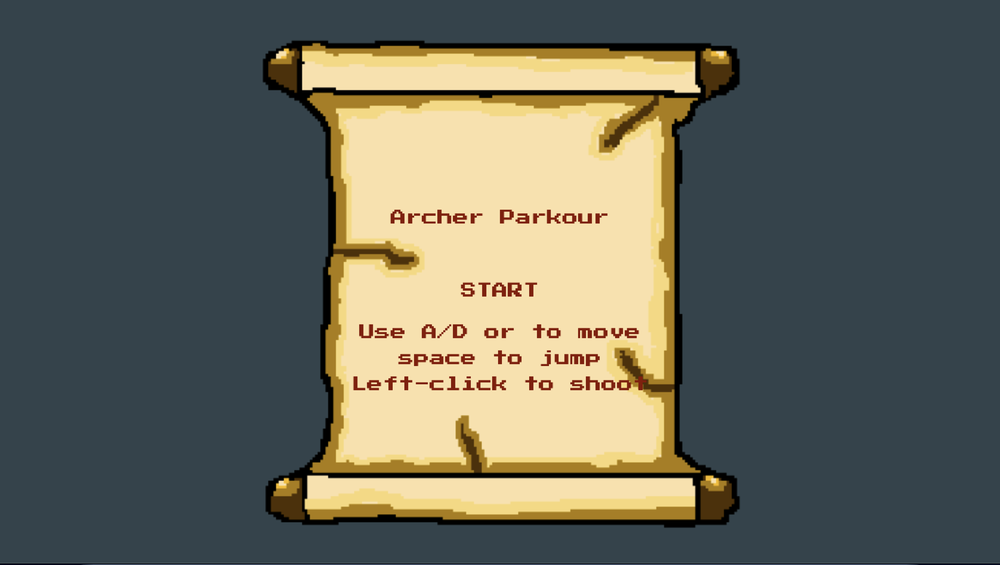
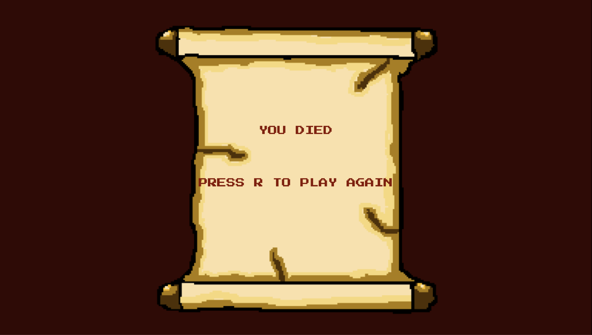

# ARCHER PARKOUR

**A cool browser game where you play a roman archer and have to pass a level by shooting at every target in the map**

## Screenshots & gameplay

| gameplay |  player design |
| :---: | :---: | 
|  |  |
| **start screen** | **death screen** |
|  |  |

## Usage

Starting this game is just as easy as opening this link [Archer Parkour](https://belakind.github.io/archer-parkour/) in your browser. Have fun playing!

## Controls

- Use A/D to move left and right (or arrow keys)
- Space to jump
- move your mouse up/down to aim
- left-click to shoot
- esc to pause the game and unlock your cursor
- press R to respawn when you died or won

## Built with

This game is completly built with vanilla browser technologies, mostly with javascript. No external frameworks or libraries were used.

- **HTML5** Just for the basic structure (creating a canvas element and loading every needed .js file)
- **CSS3** Used for styling. In this case to give the canvas a size and aspect ratio
- **JavaScript (ES6+)** Powers the complete game (mechanics, rendering, world, logic)

## New features & changes

- better physics for the arrows (rotating in flight direction)
- textures for solid tiles arrows, the player and targets. Also a texture for start menu, pause screen, death screen and win screen
- start screen with brief controls tutorial
- pause screen (gaame pauses automatically when you dont focus the window anymore or press esc)
- new level design
- improved level loading (from a png file)

## Coming soon

- more and better animations for all objects
- enemies
- multiple levels

## Known bugs

- The hitbox of the player is not matching the image you see
- Targets are solid tiles the player can stand on

## Side note

I'm building this game for terra by Hack Club. This was my work of the first three weeks, updates will come in the next weeks of the terra event.

## Credits

- **Font:** 'Press Start 2P' designed by [CodeMan38](https://zone38.net) (Licensed under [SIL Open Font License 1.1](http://sil.org))